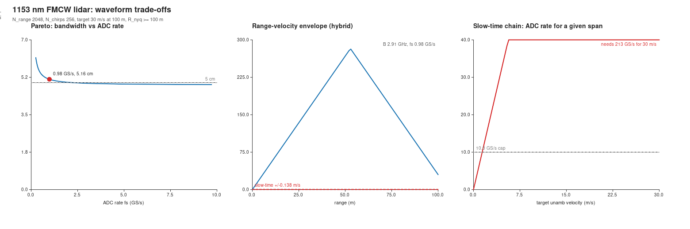
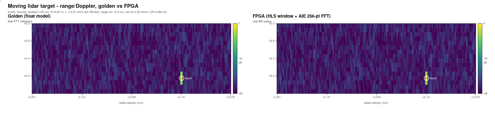
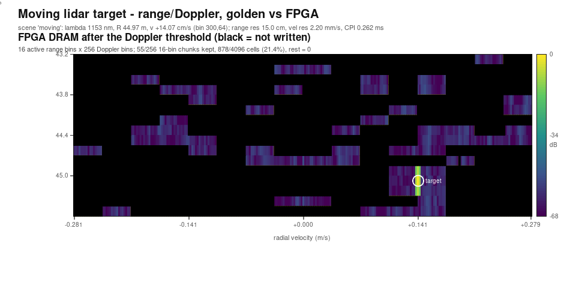
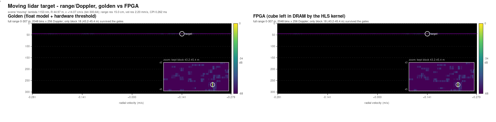

# serious-aie-fft

A range–Doppler processing chain for a 1153 nm FMCW lidar, split between a
Versal AI Engine array and an HLS PL kernel. The point of the design is to
**never store what the scene did not return**: both FFTs are followed by an
adaptive threshold, so the DRAM cubes only hold the range and Doppler bins
that actually contain energy.

```
ADC ──► HLS window ──► AIE 2048-pt range FFT ──► AIE range threshold
                                                        │
                                          kept 16-bin blocks only
                                                        ▼
                                            DRAM range cube (sparse)
                                                        │
                                      AND of the 128-bit masks over 256 chirps
                                                        │
                                                        ▼
                            HLS Doppler window ──► AIE 256-pt Doppler FFT
                                                        │
                                          per-range-bin median threshold
                                                        ▼
                                            DRAM Doppler cube (sparser)
```

## Repository layout

| Path | What it is |
|---|---|
| `central-controller-element/` | The HLS PL kernel (`kernel`, 11 ports), its testbench and Python models |
| `aie_component/` | AIE graph for the 2048-point range FFT + range threshold kernel |
| `fft_accelerator_component/` | Combined AIE graph: 2048-pt range FFT, 256-pt Doppler FFT, 128-pt angle FFT |
| `hls.sh` | HLS build/test helper (`csim`, `cosim`, `syn`, `impl`, `package`) |
| `central-controller-element/tb/` | Scene generator, end-to-end test, AIE cross-checks, plotting |
| `docs/img/` | Plots referenced below |

The parts that do the real work:

- `central-controller-element/src/main.cpp` — the 11-port `kernel()`, dataflow
  wiring and the three-cube DRAM map.
- `central-controller-element/src/range_part.cpp` — `adc_forward()`
  (Q15 Hamming + even/odd split) and `aie_range_consume()` (mask walk, burst
  the kept blocks into DRAM).
- `central-controller-element/src/doppler_part.cpp` — `seq_generator()` (the
  256-chirp AND), `doppler()` (read one block, Q15 window, hand to AIE),
  `aie_consume_doppler()` (median threshold, conditional write-back).
- `aie_component/src/threshold_kernel_better.cpp` — the range-side block
  threshold.
- `central-controller-element/tb/rd_test.py` — scene synthesis, the golden
  fixed-point model, and every check.

## Signal model

One frame is `2048 range bins × 256 chirps` of complex IQ. The transmitter is
a sawtooth FMCW lidar; a target at range `R` produces a beat tone at
`f_b = 2 B R / (c T)` and a per-chirp Doppler phase `4π R / λ`.

| Parameter | Value |
|---|---|
| Wavelength | 1153 nm |
| Sweep bandwidth `B` | 1.0 GHz |
| Sample rate | 2 GS/s |
| Range samples / chirp | 2048 |
| Chirps / frame | 256 |
| Chirp time `T` | 1.024 µs |
| CPI | 262.1 µs |
| Range resolution `c/2B` | 15.0 cm |
| Max unambiguous range | 307.0 m |
| Velocity resolution `λ/(2·CPI)` | 2.199 mm/s |
| Unambiguous velocity `λ/(4T)` | ±0.281 m/s |

Positive Doppler means approaching. The 10 m/s scene intentionally aliases in
this waveform; the measured velocity is meant to be used later, together with
the angle stage, to correct the reported range.

## End-to-end pipeline

### 1. HLS front end — `adc_forward()`

Every chirp is multiplied by the Q15 Hamming table (`hamming_window_2048`) and
split into even and odd sample streams, two cint16 samples per 64-bit beat.
This is the only place the raw ADC is touched.

### 2. Range AIE graph — `aie_component`

```
PLIO in0/in1 ──► 2048-pt FFT (TP_SHIFT = 11) ──► threshold_kernel_better ──► PLIO out0/out1
```

The threshold kernel works on 16-bin blocks, not on single bins:

1. Buffer the 2048-bin frame, compute `|x|²` and one mean per 16-bin block
   (128 block means).
2. Build a 64-bin histogram of the **block means** over `[0, 4·mean]`, find the
   median with a coarse pass, then re-histogram over `[0, 4·median]` for a
   tighter estimate.
3. Take the mode of the half-filled histogram, convert the Gamma(16) mode to
   a mean (`×16/15`), and scale it by `10^(8.393/10)` (= `-ln(1e-3)`, a
   per-bin false-alarm rate of 1e-3).
4. A block is kept if **any** of its 16 bins exceeds the threshold.

Output per chirp: 64 mask words (128 bits) followed by the payload of only the
kept blocks, alternating between the two output streams.

### 3. Sparse range cube — `aie_range_consume()`

The HLS side reads the 64 mask beats, rebuilds the list of kept 16-bin block
indices with `build_mask_indices()`, and bursts each kept block into the range
cube. The payload is 16 words per block; the mask is forwarded to
`seq_generator()`.

Nothing else is written. A rejected block is never touched, so DRAM keeps
whatever was there before — which is why an untouched cube reads back as
zeros in a fresh testbench run.

### 4. Persistence AND — `seq_generator()`

Per chirp the kernel ANDs the 128-bit mask into a per-sequence accumulator.
When chirp 255 arrives it emits the index of every block that survived **all
256 chirps**, then a single `ADDR_END` sentinel. This is the actual selector:
a single chirp's threshold is deliberately loose, and persistence across the
frame is what rejects noise.

One caveat that follows directly from N-of-256: a range bin must be occupied
in **every** azimuth column. A small object that only covers part of the scan
is dropped, while a wall that fills the frame survives.

### 5. Doppler — `doppler()`

For each surviving block index:

1. Read 16 range bins × 256 chirps from the range cube (one 16 KiB burst).
2. Q15 Hamming each 256-sample chirp vector (`hamming_window_256`).
3. Send the 16 vectors to the AIE 256-point FFT (`TP_SHIFT = 4`).

The shift is chosen so a per-frame median threshold stays well above zero: at
shift 8 the fixed-point magnitudes collapse and most frames threshold to zero.

### 6. Doppler threshold — `aie_consume_doppler()`

For each of the 16 range bins:

1. Compute all 256 powers `|X|²`, their mean, and a 64-bin histogram over
   `[0, 4·mean]`.
2. Find the median bin, reconstruct the median power at the bin centre, and
   multiply by `6.9072` (= 8.393 dB).
3. Keep a whole 16- Doppler-bin chunk if any of its 16 cells exceeds the
   threshold; only kept chunks are written to the Doppler cube.
4. Ship the keep mask, sequence/range index and the 256 powers to the PL
   (three ranks of 86 values) for the CFAR/point stage.

Again the write granularity is 16 bins, so a noise chunk can pass when one of
its 16 cells crosses the threshold. The measured result on the moving scene is
21.4 % of the processed cells written.

## DRAM layout

One cube is `128 sequences × 2048 range × 256 chirps` cint16 words
(67,108,864 words = 256 MiB). Three cubes are reserved back to back in one
`mm` allocation (768 MiB): range, Doppler and angle.

```
range_bin_ptr  (seq, chirp, index) -> [seq][chirp][index]   fast time contiguous
doppler_bin_ptr(seq, chirp, index) -> [seq][index][chirp]   slow time contiguous
```

`seq` is the sequence/frame slot. The testbench uses sequence 0; the
accumulator arrays already support 128.

## Fixed point

- ADC and FFT data: `cint16`.
- Windows: Q15 integer Hamming tables, complex multiply with 32-bit
  intermediates and symmetric saturation.
- Range FFT output shift: **11**.
- Doppler FFT output shift: **4**.
- Threshold constants: `10^(8.393/10) = 6.9072`, applied to a power estimate.
- The golden model in `rd_test.py` reproduces all of this bit for bit,
  including the C++ float rounding in the threshold estimators.

## Testbench

`rd_test.py` synthesizes float scenes, quantizes only at the hardware
boundaries, writes `tb/work/adc.txt`, and later checks every stage against the
same model.

Scenes (`--scene`):

| Scene | Content |
|---|---|
| `rd` | 4 targets, mixed amplitudes and Doppler bins |
| `sparse` | 4 weak targets |
| `dense` | 8 targets, one per block, increasing Doppler |
| `moving` | one physical 1153 nm lidar target, 44.97 m, +14.07 cm/s |

`tb/test.cpp` drives the unmodified kernel in three stages:

1. `adc_forward()` on the generated ADC, then `run_aie.sh` runs the real
   x86 simulator for the 2048-point range graph, chirp by chirp.
2. `aie_range_consume()` + `seq_generator()` + `doppler()` with the AIE range
   and Doppler payloads preloaded, exactly as the PL would see them.
3. `rd_test.py --check` compares the Q15 windows, the range cube, the Doppler
   window, the Doppler FFT and the final cube, then checks the target peaks.

`doppler_aie_check.py` adds an independent check: it runs the real 256-point
AIE FFT on the strongest frame and compares it against the Python FFT.

### Run it

```bash
# full range–Doppler frame (needs Vitis + x86simulator)
SCENES="moving" ./central-controller-element/tb/run_test.sh

# several scenes
SCENES="rd sparse dense moving" ./central-controller-element/tb/run_test.sh

# rebuild the AIE graph after a graph.h change
./fft_accelerator_component/x86sim.sh build
```

`run_test.sh` enters the `myubuntu` distrobox automatically. In an environment
where the Vitis tools are already on PATH, set
`DISTROBOX_ENTER_PATH=/nonexistent` to skip the re-entry.

### Plots

```bash
python3 central-controller-element/tb/moving_plot.py          # golden vs FPGA
python3 central-controller-element/tb/moving_dram_plot.py     # post-threshold DRAM
python3 central-controller-element/tb/moving_fullrange_plot.py
python3 central-controller-element/tb/shift_sweep.py          # TP_SHIFT sweep
python3 central-controller-element/tb/range_mask.py           # AIE-only mask stats
```

## Waveform design

`tb/waveform_optimizer.py` sweeps bandwidth and ADC rate under the constraints
`R_nyq >= 100 m` and `v = 30 m/s at 100 m`, for the current chirp-to-chirp
Doppler and for an automotive dual-slope estimator.

The short version:

- The current chain's unambiguous velocity is `lambda/(4T) = lambda fs/(4N)`.
  Bandwidth does not enter it. For 30 m/s it would need `fs = 213 GS/s`
  (`T = 9.6 ns`); at a 10 GS/s ADC the limit is 1.41 m/s.
- Raising `B` to 3 GHz and `T` to 2 us buys range resolution (15 cm -> 5 cm)
  and finer velocity resolution, but it *halves* the slow-time span.
- The automotive fix is to measure the Doppler shift of the beat itself with
  alternating up/down chirps. The usable envelope is triangular in range,
  `v_max(R) = lambda fs/2 * min(R/R_nyq, 1-R/R_nyq)`, and the slow-time phase
  is kept only for fine resolution (hybrid unwrapping).

Recommended point for 100 m / 30 m/s / ~5 cm:

| Quantity | Value |
|---|---|
| Bandwidth | 2.91 GHz |
| Range resolution | 5.16 cm |
| Nyquist range | 105.6 m |
| ADC rate | 0.98 GS/s |
| Chirp time | 2.09 us |
| Velocity envelope | 282 m/s peak (at ~53 m), 30 m/s at 100 m |
| Fine velocity resolution | 1.08 mm/s (slow-time, unwrapped) |
| Coarse dual estimate | 24 mm/s (128 pairs) |
| Range-Doppler coupling at 30 m/s | 5.6 m (removed by dual-slope) |



The minimum-ADC variant meeting 6 cm is 0.29 GS/s / 2.52 GHz / 7.08 us, but
the 1 GS/s point keeps much more velocity headroom for a small cost.

## Measured behaviour

### DRAM traffic per 2048 × 256 frame

Raw ADC is 2048 KiB. The range write happens per chirp, before the AND, so it
pays for the loose recall threshold.

| Scene | Range write | Blocks after AND | Doppler read | Doppler write | Never-read range writes |
|---|---:|---:|---:|---:|---:|
| `rd` | 142 KiB | 6 | 96 KiB | 16 KiB | 46 KiB |
| `sparse` | 127 KiB | 5 | 80 KiB | 13 KiB | 46 KiB |
| `dense` | 290 KiB | 16 | 256 KiB | 44 KiB | 34 KiB |
| `moving` | 68 KiB | 1 | 16 KiB | 3.4 KiB | 52 KiB |

The last column is the price of streaming: at chirp 0 the frame's AND is
unknown, so a block that later loses the AND has already been written.

### Threshold selectivity (real AIE masks)

| Scene | Per chirp kept | After 256-chirp AND | Union over frame |
|---|---:|---:|---:|
| `rd` | 6.9 % | 4.7 % | 127/128 blocks |
| `sparse` | 6.2 % | 3.9 % | 127/128 blocks |
| `dense` | 14.1 % | 12.5 % | 128/128 blocks |

Every block trips the loose per-chirp threshold at least once; only the
target neighbourhoods survive all 256 chirps.

### Doppler shift sweep

`TP_SHIFT = 4` gave 710 blocks with 0 zero-threshold frames, 0 target misses
and 0 clamps. Shifts 6–8 produced 232/256 zero-threshold frames and about
3,750 blocks — the fixed-point spectrum had collapsed below the noise
threshold.

### Moving 1153 nm scene

Golden (float model with both hardware shifts) against the real chain
(HLS window + AIE 256-point FFT):

- peak at range bin 300, Doppler bin 64 (+0.141 m/s), in both
- all-cell power correlation **0.999999998**
- above noise + 10 dB: max difference **0.32 dB**, mean **0.05 dB**
- one active range block (bins 288–303, 43.17–45.42 m)
- 878 / 4096 Doppler cells written (21.4 %), 3.4 KiB total

## Plots

Golden vs FPGA, active block only:



What actually remains in DRAM after the Doppler threshold (black = never
written):



Full range axis, 0–307 m, with the kept block magnified:



## Notes and limitations

- **N-of-256 persistence.** A range bin must return in all 256 chirps. This is
  what makes the gate selective, but it also means a localized object that
  only spans part of the scan is dropped. The range mask is a recall stage;
  the AND is the selector.
- **16-bin write granularity** on both axes. A chunk is kept if any cell
  crosses, so a fraction of noise always survives (21.4 % on the moving
  scene). This is a DRAM-burst/streaming trade-off, not a model error.
- **Doppler ambiguity.** `λ/(4T) = ±0.281 m/s`. The 10 m/s scene aliases; the
  apparent bin is a wrapped velocity.
- **Range migration** within a CPI is ignored in the moving scene (2.6 mm at
  10 m/s). The measured velocity is intended to correct the range later, once
  the angle stage produces points.
- **Angle stage.** `angle_part.cpp` and the 128-point AIE FFT graph exist, but
  the angle path is not wired into this testbench yet.
- **Single sequence.** `seq_generator()` accumulates all 128 sequences but the
  current end marker and testbench use sequence 0 only.
