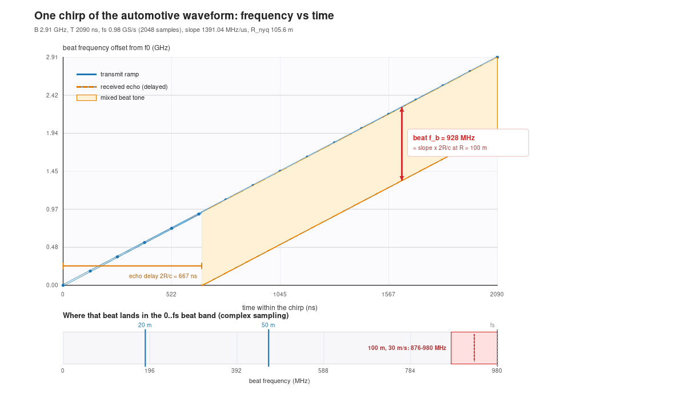
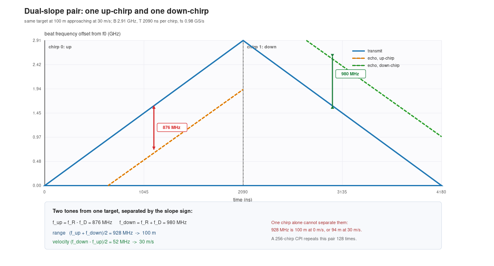
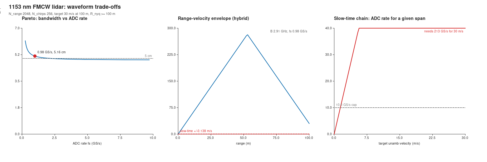

# Automotive waveform for the 1153 nm FMCW lidar

**Design note — proposal for external review.**
Target: keep the existing 2048 × 256 range–Doppler chain, but make the waveform
usable at automotive speeds: **100 m unambiguous range and 30 m/s unambiguous
velocity at that range**, with ~5 cm range resolution.

Status: analysis and simulation only. Nothing in this note has been run on
hardware. The only measured numbers are those of the *current* waveform
(1 GHz / 2 GS/s), which are marked as such.

---

## 1. TL;DR

* The present chain measures ±0.281 m/s unambiguously. That is not a tuning
  problem, it is structural:

  ```
  v_unamb = lambda / (4 T) = lambda fs / (4 N_range)
  ```

  Bandwidth does not appear in it. Reaching 30 m/s with chirp-to-chirp Doppler
  would need **fs = 213 GS/s** (T = 9.6 ns), which is not a lidar front end.
* Increasing bandwidth and chirp time, the obvious first move, improves range
  resolution but *reduces* the velocity span.
* Proposal: **alternate the slope sign every chirp** (up, down, up, down …) and
  measure the Doppler shift of the beat itself. The velocity span then comes
  from `fs`, not from `T`:

  ```
  v_max(R) = (lambda fs / 2) * min(r, 1 - r),   r = R / R_nyq
  ```

  and it is a *triangular* envelope with a peak of `lambda fs / 4` at half the
  unambiguous range.
* Recommended point for 100 m / 30 m/s / ~5 cm:
  **B = 2.907 GHz, fs = 0.98 GS/s, T = 2.090 us**, ΔR = 5.16 cm,
  R_nyq = 105.6 m, v_max(100 m) = 30.0 m/s, peak 282.5 m/s at 52.8 m.
* Keep the slow-time FFT: its phase progression across chirps is independent
  of the slope sign, so it still supplies ~1.1 mm/s fine resolution. The
  dual-slope estimate only has to be good enough to unwrap it.
* Cost: two sub-frames per CPI, up/down peak pairing (ghost risk in dense
  scenes), a 2.9 GHz sweep at 1153 nm, and almost no margin at exactly 100 m.

---

## 2. Where the design starts

The implemented chain: 11-port HLS kernel, AIE 2048-point range FFT
(`TP_SHIFT = 11`), AIE range threshold, sparse range cube in DRAM, 256-chirp
persistence AND, AIE 256-point Doppler FFT (`TP_SHIFT = 4`), Doppler threshold,
sparse Doppler cube. FFT sizes and the dataflow are fixed constraints.

Current waveform:

| Parameter | Value |
|---|---|
| Wavelength | 1153 nm |
| Sweep bandwidth B | 1.0 GHz |
| Sample rate fs | 2 GS/s |
| Samples / chirp | 2048 |
| Chirp time T | 1.024 us |
| Chirps / CPI | 256 |
| CPI | 262.1 us |
| Range resolution c/2B | 14.99 cm |
| Max unambiguous range | 307.0 m |
| Velocity resolution lambda/(2 CPI) | 2.199 mm/s |
| **Unambiguous velocity lambda/(4T)** | **±0.281 m/s** |

The moving-scene test (`tb/rd_test.py`, scene `moving`) is a physical 1153 nm
target at 44.97 m moving at 14.07 cm/s; it passes with 0.999999998 correlation
against the golden fixed-point model. That verifies the chain, not the
waveform.

---

## 3. Why the current velocity span cannot be fixed by bandwidth

Per chirp, the beat frequency of a target at range `R` is

```
f_R = 2 B R / (c T)
```

and the target's motion adds a Doppler shift `f_D = 2 v / lambda` on top of it.
Chirp to chirp, the *phase* of the range-compressed signal advances by

```
dphi = 4 pi v T / lambda      ->     v_unamb = lambda / (4 T)
```

With `T = N_range / fs`:

```
v_unamb = lambda fs / (4 N_range)
```

Consequences, all confirmed by `tb/waveform_optimizer.py`:

| fs | T | v_unamb | velocity resolution |
|---|---|---|---|
| 1 GS/s | 2.048 us | 0.141 m/s | 1.10 mm/s |
| 2 GS/s | 1.024 us | 0.281 m/s | 2.20 mm/s |
| 5 GS/s | 0.410 us | 0.704 m/s | 5.50 mm/s |
| 10 GS/s | 0.205 us | 1.407 m/s | 11.0 mm/s |

A 10 GS/s ADC still gives only 1.4 m/s, and it *degrades* the resolution. For
30 m/s the formula demands 213.1 GS/s. Bandwidth buys range resolution and
nothing else here; chirp time actively works against velocity.

So the velocity span has to come from somewhere other than the chirp-to-chirp
phase. It has to come from the beat frequency itself.

---

## 4. Dual slope

### 4.1 The two measurements

Send an up-chirp, then a down-chirp of the same duration and bandwidth. For an
approaching target:

```
up:    f_up   = f_R - f_D
down:  f_down = f_R + f_D
```

so

```
R     = c T (f_up + f_down) / (4 B)
v     = lambda (f_down - f_up) / 4
```

Both tones are measured in the same 2048-point range FFT; the sign of the
slope is what separates them. The peak separation is `2 f_D`, which at 30 m/s
is 104 MHz — about 217 range bins, or 11.2 m. That is large: it is the main
implementation problem, see §7.2.



*One up-chirp. The echo from 100 m arrives 2R/c = 667 ns late, so the mixer
output is a tone at 928 MHz. The next chirp mirrors the ramp.*



*The pair. Chirp 0 up, chirp 1 down, repeated 128 times per CPI. At 100 m and
30 m/s the two beats are 876 MHz and 980 MHz; their average gives range, their
difference gives velocity.*

### 4.2 The envelope, and why it is triangular

With complex (I/Q) sampling the beat must stay inside `[0, fs]`:

```
0 <= f_R - f_D        ->  f_D <= f_R
     f_R + f_D <= fs  ->  f_D <= fs - f_R
```

Therefore

```
f_D <= min(f_R, fs - f_R)
v_max(R) = (lambda/2) min(f_R, fs - f_R)
         = (lambda fs / 2) min(r, 1 - r),      r = R / R_nyq
```

The envelope peaks at `lambda fs / 4` at `R = R_nyq / 2` and collapses to zero
at both ends of the range window. This is the fundamental price of the method:
**high velocity is only unambiguous in the middle of the range window.**

At the recommended point (`fs = 0.98 GS/s`): peak 282.5 m/s at 52.8 m,
30.0 m/s at 100 m, 53.5 m/s at 10 m, 5.3 m/s at 1 m. Near-range targets are
slow in practice, but a 30 m/s closing target at 3 m would already alias.

### 4.3 The ambiguity it removes

At 100 m, a single slope gives one number: 928 MHz. That is 100 m at 0 m/s, or
94.4 m at 30 m/s, or anything on the line `f_R - f_D = 928 MHz`. The coupling
is

```
dR = v c T / (lambda B) = 5.61 m at 30 m/s
```

so the up/down average cancels it to first order, and the difference measures
it. This is the whole argument for the second slope: range–Doppler coupling is
not a nuisance to be corrected afterwards, it is the velocity measurement.

---

## 5. Hybrid: coarse dual + fine slow-time

The dual estimate is coarse. The slow-time phase is fine but aliased. Use the
first to unwrap the second.

* The slow-time phase across chirps is `4 pi v T / lambda` **regardless of the
  slope sign**, because it is the carrier phase, not the modulation. So the
  existing 256-point Doppler FFT still produces a fine velocity axis with
  `dv = lambda / (2 CPI)`.
* Its span is ±`lambda/(4T)` = ±0.138 m/s, i.e. one Doppler cell every
  1.078 mm/s for 256 chirps.
* The dual estimate over 128 pairs has a coarse resolution of order
  `lambda/(2T)/sqrt(128)` = 24.4 mm/s (a scaling estimate, not a CRLB).
  That is 5.7× smaller than the ±69 mm/s half-span it must unwrap, so the
  cascade has margin.

The same quantity appears twice: `f_D` measured as a beat shift, and `f_D`
measured as a slow-time phase slope. That redundancy is the point.

---

## 6. Sizing the waveform

### 6.1 Constraint solve

For a required velocity `v` at reference range `R_ref`, with `x = R_ref/R_nyq`:

```
x >= q        and    1 - x >= q,        q = 2 v / (lambda fs)
=>  q <= x <= 1 - q
```

The largest useful bandwidth is the one that puts the reference range at the
top edge, `x = 1 - q`:

```
B_max = N_range c (1 - q) / (2 R_ref)
```

capped by the range requirement `R_nyq >= R_min` and by the laser bandwidth.
This is exactly what `b_for_dual()` in `tb/waveform_optimizer.py` does.

### 6.2 Pareto front (fs = 0.98 GS/s highlighted)

| fs (GS/s) | B (GHz) | T (ns) | R_nyq (m) | ΔR (cm) | v at 100 m | peak v | dv hybrid |
|---:|---:|---:|---:|---:|---:|---:|---:|
| 0.25 | 2.43 | 8192 | 126.3 | 6.17 | 30.0 | 72.1 | 0.27 mm/s |
| 0.49 | 2.75 | 4138 | 111.7 | 5.46 | 30.0 | 142.7 | 0.54 mm/s |
| **0.98** | **2.91** | **2090** | **105.6** | **5.16** | **30.0** | **282.5** | **1.08 mm/s** |
| 1.94 | 2.99 | 1056 | 102.8 | 5.02 | 30.0 | 559.3 | 2.13 mm/s |
| 3.84 | 3.03 | 533 | 101.4 | 4.95 | 30.0 | 1107 | 4.22 mm/s |
| 7.99 | 3.05 | 256 | 100.7 | 4.91 | 30.0 | 2302 | 8.78 mm/s |



The bandwidth is essentially pinned near 3 GHz by the 100 m / 30 m/s
constraint; the ADC rate then trades velocity headroom against CPI and
resolution. The minimum-rate design that still meets 6 cm is
**0.29 GS/s, 2.52 GHz, 7.08 us**, but its peak envelope is only 83.6 m/s.

### 6.3 Recommended point

| Quantity | Value |
|---|---|
| Bandwidth | 2.907 GHz |
| Range resolution | 5.156 cm |
| Nyquist range | 105.61 m |
| Sample rate | 0.980 GS/s |
| Chirp time | 2.0898 us |
| Slope | 1.391 MHz/us |
| CPI (256 chirps) | 535.0 us |
| Range bin | 478.5 kHz / 5.156 cm |
| v_max at 100 m | 30.0 m/s |
| Peak v (52.8 m) | 282.5 m/s |
| v_max at 10 m | 53.5 m/s |
| Doppler shift at 30 m/s | 52.0 MHz (108.7 range bins) |
| Range–Doppler coupling at 30 m/s | 5.61 m |
| Fine dv (slow-time, 256 chirps) | 1.078 mm/s |
| Coarse dual dv (128 pairs) | ~24.4 mm/s |
| Physical migration in one CPI at 30 m/s | 1.6 cm (0.31 bin) |

The last line matters: **range walk within the CPI is negligible**; what moves
the peak between the up and down chirps is the Doppler shift of the beat, not
target motion.

### 6.4 Sensitivity

Each 1 m/s of extra velocity at 100 m costs about 5.4 MHz of bandwidth:

| v at 100 m | B | R_nyq | ΔR | peak v |
|---|---:|---:|---:|---:|
| 30 m/s | 2.907 GHz | 105.6 m | 5.16 cm | 282.5 m/s |
| 35 m/s | 2.880 GHz | 106.6 m | 5.21 cm | 285.6 m/s |
| 40 m/s | 2.852 GHz | 107.6 m | 5.25 cm | 288.6 m/s |

Given that 30 m/s at 100 m lands *exactly* on the envelope, I would recommend
sizing for 35 m/s and accepting the 0.5 % range-resolution loss.

---

## 7. What this does to the implemented chain

This is the part I most want reviewed.

### 7.1 Range path

Unchanged: 2048 samples, Hamming, AIE 2048-point FFT, 16-bin block threshold,
persistence AND, sparse cube. Only the bin meaning changes:

* 5.156 cm per bin instead of 14.99 cm;
* a 16-bin threshold block is now 82.5 cm instead of 2.4 m;
* `R_nyq` drops from 307 m to 105.6 m, so the mask covers 105.6 m with the same
  128 blocks, i.e. 0.825 m per block.

The threshold kernel's block-mean statistics still apply, but the Gamma(16)
assumption and the median/mode fit now see a scene with much finer range
sampling. Worth re-measuring the false-alarm rate on the `dense` scene.

### 7.2 Doppler path — the real problem

If the slope alternates every chirp, then for a moving target the range peak
alternates between `f_R - f_D` and `f_R + f_D`, i.e. **between range bins 217
apart**. The 256-chirp Doppler FFT would see a signal that jumps between two
different range bins, which breaks the slow-time sequence for that bin.

Three options:

1. **Two sub-frames (recommended).** Treat up-chirps and down-chirps as two
   128-chirp sequences. Each gets its own range mask and persistence AND, and
   each is Doppler-processed separately. The 256-point AIE FFT can process 128
   real chirps zero-padded, so the IP does not change; the Doppler pass runs
   twice per range block, doubling that part of the compute and the Doppler
   read/write traffic.
2. **Compensate the range shift before the Doppler FFT.** Requires knowing
   `f_D` to shift each chirp's spectrum back, which is what we are measuring —
   a two-pass scheme (coarse estimate, then realign) would work but adds a
   feedback path through DRAM.
3. **Do not range-FFT per chirp for the Doppler stage.** Keep the raw beat and
   do the dual estimate first, then a single Doppler FFT after correction.
   Cleaner mathematically, but it discards the sparse-cube architecture.

I recommend (1) because it preserves the block/AND/threshold structure and
makes the two measurements independent.

Under (1) the AND is over 128 chirps instead of 256, so it is slightly less
selective. The moving scene's 21.4 % Doppler write fraction should be
re-measured; I expect it to rise.

### 7.3 Pairing and ghosts

With several targets, the up-frame and down-frame each produce peaks. A pair is
"the same target" if

```
|R_up - R_down| = 2 * 5.61 m * (v/30)  and  |v_up| = |v_down|
```

Nearest-neighbour pairing in (R, v) works for a single target and for well
separated ones. In a dense scene it produces ghosts, exactly like a
range–Doppler MIMO pairing problem. Mitigations, in increasing cost:

* constrain the pairing by the predicted 11.2 m offset (halves the search);
* require the pair to share the same Doppler cell (the slow-time phase is
  slope-independent, so both frames see the same `v` to within 1.1 mm/s);
* add a third, different slope to over-determine the fit;
* rely on the point-cloud tracker upstream.

This is the biggest algorithmic hole in the proposal and deserves a dedicated
simulation with two to four targets.

### 7.4 Thresholds, DRAM, fixed point

* Same cube layout, same 128 sequences, same sparse cubes; only the number of
  chirps per pass changes in option (1).
* The Doppler threshold's per-range-bin median is unaffected by slope sign, but
  each pass now has 128 samples instead of 256, so the median estimate is
  noisier and the `10^(8.393/10)` constant should be re-checked.
* Fixed point: `TP_SHIFT` values do not depend on the slope. `f_D = 52 MHz` is
  108 bins at 478.5 kHz, so no resolution pressure on the range FFT.
* Window, mask width, 16-bin write granularity: unchanged.

---

## 8. Validation plan

Cheap, in order, before any hardware:

1. Extend the physical scene generator to the new parameters and a 100 m,
   30 m/s target. Check the range peak lands at bin ~1939 and that the
   Doppler peak is where the aliasing formula says.
2. Build a Python dual-slope model: split chirps, two range FFTs, threshold,
   pairing, `R`/`v` estimate. Compare with truth for 1, 2 and 4 targets.
3. Run the same scene through the existing fixed-point golden model to confirm
   the slow-time phase really is slope-independent after the hardware shifts.
4. Measure the pairing ghost rate versus target density and SNR; this decides
   whether option (1) is enough.
5. Re-measure threshold selectivity and DRAM traffic for 128-chirp sub-frames.
6. Only then size the laser: 2.9 GHz of linear sweep in 2.09 us at 1153 nm,
   with coherence over the CPI.

---

## 9. Questions for the reviewer

1. Is the triangular envelope derivation right for this front end? It assumes
   complex sampling over `[0, fs]` and a real, positive beat. With real
   sampling the envelope halves.
2. Is per-slope sub-framing (§7.2) the right call, or is a two-pass
   range-shift compensation worth the DRAM round trip?
3. How would you pair up/down peaks in a dense scene without a tracker? Is a
   third slope cheaper than a tracker?
4. 30 m/s at 100 m sits exactly on the envelope. Is the right move to size for
   35–40 m/s (costs ~1 % range resolution), or to accept a velocity-dependent
   maximum range?
5. The near-range envelope collapses (5.3 m/s at 1 m). Is that acceptable for
   an automotive sensor, or does it force a second, shorter waveform?
6. The coarse dual resolution (~24 mm/s) is a scaling estimate. What is the
   realistic CRLB at, say, 10 dB SNR, and does the unwrap still hold?
7. Is a 2.9 GHz sweep realistic for a 1153 nm source (coherence, linearity,
   modulator bandwidth), or does this proposal silently require a different
   laser?
8. Does anything in the fixed-point chain (window, shifts, median threshold)
   break when the chirp count per Doppler pass halves?

---

## Appendix A — formulas used

```
f_R        = 2 B R / (c T)
f_D        = 2 v / lambda
R_nyq      = N_range c / (2 B)
ΔR         = c / (2 B)
T          = N_range / fs
v_slow     = lambda fs / (4 N_range)
dv_slow    = lambda / (2 N_chirps T)
v_dual(R)  = (lambda fs / 2) min(R/R_nyq, 1 - R/R_nyq)
coupling   = v c T / (lambda B)
```

## Appendix B — numbers at the recommended point

```
lambda     1153 nm
B          2.9068 GHz
fs         0.980 GS/s
T          2.0898 us
N_range    2048
N_chirps   256
ΔR         5.156 cm
R_nyq      105.61 m
f_bin      478.5 kHz
CPI        535.0 us
v_max(100) 30.0 m/s
v_peak     282.5 m/s at 52.8 m
dv_slow    1.078 mm/s
f_D(30)    52.04 MHz = 108.7 bins
f_up       876.0 MHz
f_down     980.0 MHz
coupling   5.61 m
```

## Appendix C — files

| File | What it does |
|---|---|
| `central-controller-element/tb/waveform_optimizer.py` | design-space sweep, Pareto table, trade-off plot |
| `central-controller-element/tb/waveform_chirp_plot.py` | one-chirp frequency–time figure |
| `central-controller-element/tb/waveform_pair_plot.py` | up/down pair figure |
| `central-controller-element/tb/rd_test.py` | scene generator, golden fixed-point model, checks |
| `central-controller-element/src/doppler_part.cpp` | persistence AND, Doppler threshold |
| `fft_accelerator_component/src/graph.h` | AIE range/Doppler graphs, `TP_SHIFT` |

The optimizer runs with no arguments for the defaults used here:

```bash
python3 central-controller-element/tb/waveform_optimizer.py
```
